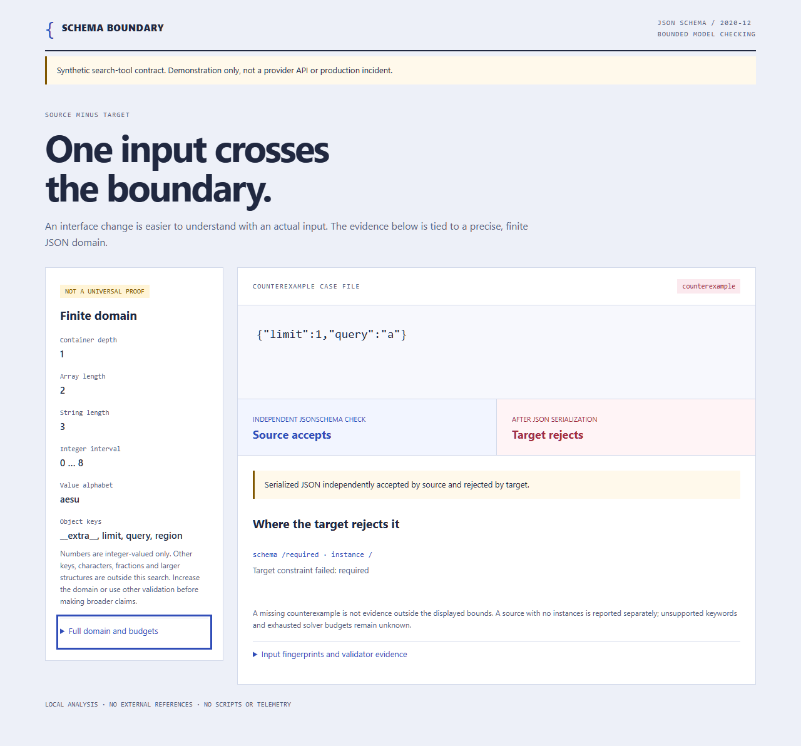

# Schema Boundary

**Show the input that breaks your new contract.**

Given two JSON Schemas, find a concrete JSON value that the **source accepts and the target rejects**. Useful for reviewing AI-tool parameters, structured-output contracts and API input changes. Every reported counterexample is serialized, parsed again, and checked by the independent `jsonschema` validator.

This is an experimental **bounded** checker, not a universal schema-subsumption proof or a full OpenAPI diff tool. A solver's UNSAT result is always labeled `bounded-compatible`, with the complete finite domain attached. It does not exit 0 by default.

[中文快速说明](README.zh-CN.md) · [Offline example](docs/demo/report.html) · [Design](docs/DESIGN.md) · [Verification](docs/VERIFICATION.md)



## Run a real counterexample

Python 3.10+. From this repository or extracted source distribution:

```sh
python -m pip install .
schema-boundary compare examples/search.old.json examples/search.new.json --domain examples/domain.json --output review-case
```

**Exit 1 is expected:** the new contract breaks a previously accepted input. Open `review-case/report.html` and inspect `review-case/witness.json`. The examples describe a synthetic search-tool contract, not a real provider API or production incident. A representative counterexample lacks the newly required `region`; the solver may produce a different valid witness on another version.

```sh
# Relaxed contract: exit 3, not unqualified success
schema-boundary compare examples/search.old.json examples/search.relaxed.json --domain examples/domain.json

# An explicit, conscious CI policy: only now can bounded-compatible exit 0
schema-boundary compare examples/search.old.json examples/search.relaxed.json --domain examples/domain.json --accept-bounded

# Unsupported regex: unknown / exit 2, never silently ignored
schema-boundary compare examples/search.old.json examples/unsupported.json
```

`python -m schema_boundary` is equivalent to the command. This project is not yet published to PyPI; do not install an unrelated same-named package. No hosted release is claimed by this source snapshot.

## Why a concrete witness?

A textual change such as `required += ["region"]` can be misleading inside `anyOf`, `not`, or multiple object constraints. Schema Boundary solves `source(x) AND NOT target(x)` over one explicit domain, then gives you an ordinary JSON object and the target's failing JSON Pointer paths. You can independently validate that file, attach it to a review, or turn it into a regression case.

A separate source-satisfiability check prevents an empty search domain from being presented as reassuring compatibility. The reported witness is not promised globally smallest, unique, or stable across solver versions.

**Direction matters:** old input contract -> new input contract tests whether old callers remain accepted. Checking a new producer against an old consumer's output expectations often requires new -> old instead.

## Read the bounds before the verdict

Default domain:

| Dimension | Default |
|---|---|
| Container nesting | 2; depth 0 includes scalars only |
| Array length | 0..2 |
| String length | 0..8 Unicode codepoints |
| String alphabet | `abcdefghijklmnopqrstuvwxyz0123456789_-` |
| Numbers | **integers only**, -16..16 |
| Object keys | Union of both schemas' `properties`, `required` and literal-object keys, plus `__extra__` |

Every object uses a subset of that resolved key set; arbitrary other keys are not tested. A domain file overrides the dataclass options (see `examples/domain.json`). String codepoints, including non-BMP characters, are represented explicitly rather than relying on solver string escaping. JSON numeric constraints are exact rationals, but **fractional instance values are outside the universe**.

For example, `integer -> integer with maximum 2` looks bounded-compatible over integers 0..2; widening to 0..3 produces 3 as a counterexample. This intentional blind-spot control is in the tests. The smaller result is not wrong, but calling it universally compatible would be.

## Output and CI policy

| Status | Default exit | Meaning |
|---|---:|---|
| `counterexample` | 1 | Serialized instance independently passes source and fails target |
| `bounded-compatible` | 3 | No counterexample under the exact printed domain and supported encoding |
| `empty-source` | 4 | Source has no instances inside this domain; vacuity is not reassurance |
| `unknown` | 2 | Unsupported keyword, resource limit, solver unknown or independent-check disagreement |
| `error` | 2 | Invalid JSON/schema/domain/arguments or I/O error |

Only `--accept-bounded` changes bounded-compatible to exit 0. Help/version remain normal text output. Completed comparisons and errors print JSON to stdout. `--output DIR` writes `report.json`, `report.html` and, only for a confirmed counterexample, `witness.json` (including a legitimate JSON `null`). The output directory must not exist and its parent must exist. An I/O failure may leave a partial **new** directory; old files are never intentionally overwritten. Stable input files and a non-hostile local filesystem are assumed.

## Supported Draft 2020-12 subset

Boolean schemas; `type`, `const`, `enum`; numeric bounds and `multipleOf`; string length; `items`, `minItems`, `maxItems`; object `properties`, `required`, `additionalProperties` (boolean or schema), property counts; `allOf`, `anyOf`, `oneOf`, `not`.

Numeric lexemes such as `0` and `0.0` share integer semantics. Booleans are not integers. Keywords do not imply a type; `minimum` does not reject a string. `additionalProperties` is evaluated per schema object, never incorrectly merged across `allOf` branches.

Explicitly ignored annotations: `title`, `description`, `$comment`, `default`, `examples`, `deprecated`, `readOnly`, `writeOnly`. Every other unsupported schema keyword, even in an unreachable branch, yields unknown. In particular, **no** `$ref`, `$defs`, `pattern`, `format`, `prefixItems`, `uniqueItems`, `unevaluated*`, or network resolution. Literal object keys inside const/enum are data, not schema keywords.

## Resources and privacy

1 MiB/input; JSON depth 32 and 4,000 structural nodes; up to 12 resolved object keys, domain depth 3, array length 8, string length 64, alphabet 128 codepoints, and integer endpoints +/-10^12. Unrolling is capped at 3,000 symbolic nodes; predicate/literal compilation shares a 25,000-work-unit cap. Expensive enum construction is debited too.

`--timeout-ms` (default 5000, max 60000) and `--rlimit` (default 2,000,000, max 50,000,000) apply **per solver check**, not to total input parsing/compilation/wall time. Structural caps are not a hard OS memory/time sandbox. Compilation can take seconds before a solver budget is consulted. Lower domain bounds for large schemas.

No application network calls, telemetry, model API or schema-reference fetches. Reports contain canonical source hashes, the explicit domain, a witness and JSON Pointer paths—not absolute filenames or freeform schema annotation values. **Property names and literal witness data may themselves be private.** Review before sharing. Hashes are provenance aids, not authenticity signatures.

## Verify rather than trust the UI

```sh
python -m unittest discover -s tests -v
python tools/verify_mutations.py
```

Tests include independent exhaustive tiny-domain predicate evaluation, pairwise decisions against independently enumerated values, real Z3 resource exhaustion, a bad decoded-witness control, numeric/Unicode/object-locality cases and CLI output protection. Mutations run in disposable copies and must fail named assertions, not merely crash.

For an independent official corpus check, clone `json-schema-org/JSON-Schema-Test-Suite` separately and run `python tools/verify_official.py PATH`. The adapter targets the corpus revision recorded in `docs/VERIFICATION.md`; its current layout is `validation/tests/` with dialect compatibility tags. Selected tests outside our schema or domain scope are counted and named as skipped. This is **not** complete JSON Schema conformance.

## Alternatives and scope

[IBM/jsonsubschema](https://github.com/IBM/jsonsubschema) already studies schema inclusion (Draft4). [openapi-diff](https://github.com/OpenAPITools/openapi-diff) covers OpenAPI endpoint/contract changes. [Sentry/json-schema-diff](https://github.com/getsentry/json-schema-diff) implements schema difference analysis. Prefer those for their supported workflows; this project focuses on a concrete counterexample plus explicit finite limits and independent replay. It does not claim global novelty, superior coverage, or world-leading performance.

Normative references: [2020-12 validation](https://json-schema.org/draft/2020-12/json-schema-validation) and [core applicators](https://json-schema.org/draft/2020-12/json-schema-core).

MIT for original code; dependencies and reference-corpus licensing are listed in [THIRD_PARTY_NOTICES.md](THIRD_PARTY_NOTICES.md). AI-assisted development and independent review were used. Contributions should include a small synthetic counterexample or a failing independent oracle case, not private schemas or credentials.

## Quickstart and support

### Problem
Find a concrete JSON value accepted by a source schema and rejected by a target schema, with the finite search domain attached.

### Install
```sh
python -m pip install .
```

### Success
```sh
schema-boundary compare examples/search.old.json examples/search.relaxed.json --domain examples/domain.json --accept-bounded
```
Expected: The bounded-compatible result is accepted only because --accept-bounded is explicit; exit 0.

### Deliberate failure
```sh
schema-boundary compare examples/search.old.json examples/search.new.json --domain examples/domain.json --output review-case
```
Expected: A serialized counterexample is independently rechecked and the command exits 1.

### Evidence and coverage boundaries
Evidence includes independent jsonschema replay, exhaustive tiny-domain predicate evaluation, pairwise enumerated decisions, real Z3 resource exhaustion, a bad decoded-witness control, and selected official-corpus checks. A solver UNSAT is bounded-compatible over the printed domain, never a universal schema-subsumption proof.

### Support status
Version 0.1.0 is an experimental bounded checker for Python 3.10+. It is not published to PyPI according to this source snapshot; install a reviewed checkout or source distribution. Maintenance is best-effort with no SLA.

### Limitations
The default domain uses depth 2, arrays 0..2, strings 0..8 codepoints, integers -16..16, and resolved object keys. Fractional instances, $ref, patterns, formats, network resolution, and many other keywords are unsupported and produce unknown rather than silent success.
